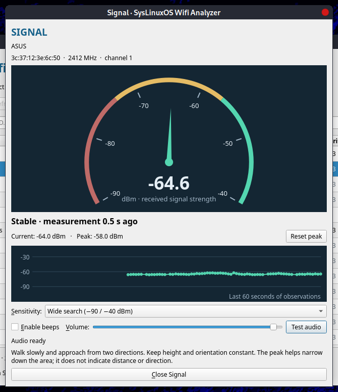

# SysLinuxOS Wifi Analyzer

[English](#english) | [Italiano](#italiano)



## English

Desktop application for locating WiFi access points hidden above suspended
ceilings or in other concealed areas, using received signal strength and audible
guidance. Version `2026.10.3`, for SysLinuxOS 13 / Debian 13. English is the
default language, with automatic support for Italian, French, German and Spanish.

Full walkthrough: [installation and usage guide](https://syslinuxos.com/syslinuxos-wifi-analyzer-installation-usage-guide/).

### Installation and launch

With the [SysLinuxOS Tools APT repository](https://github.com/fconidi/SysLinuxOS-Tools) configured:

```bash
sudo apt update
sudo apt install syslinuxos-wifi-analyzer
```

Or download the `.deb` from [GitHub Releases](https://github.com/fconidi/syslinuxos-wifi-analyzer/releases):

```bash
sudo apt install ./syslinuxos-wifi-analyzer_2026.10.3_all.deb
syslinuxos-wifi-analyzer
```

The application is also available from the **SysLinuxOS Tools** menu. Run it as
your desktop user: only scanning requires administrator authentication through
polkit. The `syslinuxos-wifi-analyzer` package replaces the previous
`syslinuxos-wify-analyzer` package; the current command is `syslinuxos-wifi-analyzer`.

You need a WiFi adapter recognized by `iw` and a polkit authentication agent in
your graphical session, normally already available on MATE/GNOME.

Building does not install or publish the package or change the computer's network
configuration. Dependencies are APT packages; avoid `sudo pip` and
`--break-system-packages`.

### Automatic language selection

The interface follows the desktop session's message locale:
`LC_ALL`, then `LC_MESSAGES`, then `LANG`. When set, `LANGUAGE` selects the first
supported language in its colon-separated list. Regional locales such as
`fr_CA.UTF-8` and `es_MX` use the corresponding FR/ES catalog. Unsupported or
missing settings and the `C`/`POSIX` locales use **EN**. The `C`/`POSIX` locale
takes precedence over `LANGUAGE`.

Available languages: **EN, IT, FR, DE, ES**. Controls, messages, accessibility
labels, application information, desktop entries and polkit prompts are
translated. SSIDs, BSSIDs and driver diagnostics retain their original text.
Language selection happens at startup; restart the application in the new
session to switch languages. To try a language from source:

```bash
LC_ALL=fr_FR.UTF-8 LANGUAGE=fr python3 source/app.py --demo
LC_ALL=C LANGUAGE= python3 source/app.py --demo  # EN
```

The instructions below use the English interface labels.

### Locating an access point above a suspended ceiling

1. Select the WiFi adapter and click **Start scan**. Confirm authentication.
2. Select the target radio by its **BSSID**, even when several APs share the same
   SSID. One physical device can expose multiple BSSIDs and bands.
3. Click **Signal…** to focus scanning on the target frequency.
4. Enable **Enable beeps** and adjust the volume. **Test audio** plays a single
   beep to check desktop audio independently of scanning.
5. Walk slowly, keeping the receiver's height and orientation constant. A higher
   gauge reading and faster beeps indicate a stronger signal.
6. Cross the strongest-signal area again from a perpendicular direction. Use
   **Reset peak** when starting a new pass. The peak is the best raw sample;
   the gauge, history and beeps use a lightly smoothed signal.
7. Select **Near the AP** to distinguish changes in already strong signals.
   Close Signal to return to discovery across all channels and select another AP.

The cadence ranges from one beep every 2.2 seconds to about six beeps per second.
The tone stays at 880 Hz. Signal strength does not provide distance or direction:
metal, obstacles and reflections can shift the strongest-signal location. Use the
result to narrow the area to inspect above the ceiling; it cannot guarantee the
correct individual panel.

### Samples and troubleshooting

- Scanning requests an `iw` cache flush and preserves the sample age reported by
  the driver. An old sample is not presented as a new measurement.
- Beeps pause immediately if a scan fails or misses the target, and after four
  seconds without a fresh measurement. They resume only after a valid new sample
  for the selected BSSID and frequency.
- Entries still visible after stopping are historical and show their age.
  Observations older than two minutes are removed.
- If the adapter is busy, the application waits and retries. If WiFi is disabled
  or blocked, enable it in desktop settings. The application does not change
  adapter mode or disable NetworkManager. A dedicated USB adapter may provide
  steadier scanning while the main adapter maintains a connection.
- Scanning speed depends on the adapter, driver and channel. Scans lasting more
  than four seconds may interrupt audible guidance. Each `iw` invocation times
  out after 15 seconds; stopping or closing may wait for that timeout.
- If the AP changes channel, close Signal and find it again in the updated list.
- The authentication prompt appears when starting a scanning session, rather
  than for each beep or sample. Cancelling authentication stops the session.

### Try without hardware

```bash
syslinuxos-wifi-analyzer --demo
# Or run from source:
python3 source/app.py --demo
```

**DEMO** mode shows two radios sharing an SSID, a hidden SSID and simulated
signal changes. It does not run `iw` or request privileges and lets you try the
gauge, filters and audio.

### Development and verification

```bash
sudo apt install python3 python3-pyqt5 python3-pyqt5.qtmultimedia iw pkexec \
    dpkg-dev desktop-file-utils
python3 -m unittest discover -s tests -v
bash build-deb.sh
```

The build runs tests, validates desktop/XML files and generates a `.deb` with
root ownership for installed files. The version is defined in `source/VERSION`.

Automated tests cover BSS parsing, fractional dBm, shared/hidden SSIDs, cache age,
target selection, smoothing, expiry, beep cadence, privileged input validation,
errors/timeouts and the Qt demo lifecycle. The backend uses fixed paths and
argument lists without a shell. The helper is isolated from `PYTHONPATH` and
user-site packages; its policy authorizes only the installed executable path.

Field acceptance checks before public distribution:

- polkit authentication, stopping and closing during a real scan;
- detecting two APs sharing an SSID on 2.4 and 5 GHz;
- audio through speakers/headphones in MATE or GNOME;
- switching off the AP: beeps pause and the gauge clears;
- walking under a known AP and repeating from two directions;
- adapter behavior while NetworkManager maintains a connection.

### Origin and license

Copyright 2026 Franco Conidi. GPL-3.0-or-later; no warranty.
The BSS parser is derived from Sparrow WiFi, Copyright 2017 ghostop14. See
[UPSTREAM.md](UPSTREAM.md) and [LICENSE](source/LICENSE). This application focuses
on WiFi discovery and does not include Sparrow's Bluetooth, SDR or DroneID features.

---

## Italiano

Applicazione desktop per trovare gli access point nascosti, ad esempio sopra un
controsoffitto, usando il segnale ricevuto e una guida sonora. Versione
`2026.10.3`, per SysLinuxOS 13 / Debian 13. Inglese predefinito con rilevamento
automatico di italiano, francese, tedesco e spagnolo.

Guida completa: [installazione e utilizzo](https://francoconidi.it/syslinuxos-wifi-analyzer-guida-installazione-utilizzo/).

### Installazione e avvio

Con il [repository APT SysLinuxOS Tools](https://github.com/fconidi/SysLinuxOS-Tools) configurato:

```bash
sudo apt update
sudo apt install syslinuxos-wifi-analyzer
```

Oppure scarica il `.deb` dalle [release GitHub](https://github.com/fconidi/syslinuxos-wifi-analyzer/releases):

```bash
sudo apt install ./syslinuxos-wifi-analyzer_2026.10.3_all.deb
syslinuxos-wifi-analyzer
```

Disponibile anche dal menu **SysLinuxOS Tools**. Avvia come utente del desktop:
solo la scansione richiede l’autenticazione amministrativa tramite polkit.
Il pacchetto `syslinuxos-wifi-analyzer` sostituisce il precedente
`syslinuxos-wify-analyzer`; il comando aggiornato è `syslinuxos-wifi-analyzer`.

Servono una scheda WiFi riconosciuta da `iw` e un agente polkit nella sessione
grafica, normalmente già presente su MATE/GNOME.

La build non installa o pubblica il pacchetto e non modifica la rete del computer.
Non usare `sudo pip` o `--break-system-packages`: le dipendenze sono pacchetti APT.

### Lingua automatica

L’interfaccia segue la lingua dei messaggi della sessione desktop:
`LC_ALL`, poi `LC_MESSAGES`, poi `LANG`. Se presente, `LANGUAGE` sceglie la
prima lingua supportata nella lista separata da `:`. Le localizzazioni regionali
(es. `fr_CA.UTF-8` o `es_MX`) usano il relativo catalogo FR/ES. Le lingue non
supportate, le impostazioni assenti e i locale `C`/`POSIX` usano **EN**.
Il locale `C`/`POSIX` prevale anche su `LANGUAGE`.

Lingue disponibili: **EN, IT, FR, DE, ES**. Sono tradotti comandi, messaggi,
accessibilità, informazioni sull’app, voce desktop e richiesta polkit. Gli SSID,
i BSSID e i dettagli tecnici restituiti dal driver mantengono il testo originale.
La lingua viene scelta all’avvio; per cambiare lingua riavvia l’app nella nuova
sessione. Per provare una lingua dai sorgenti:

```bash
LC_ALL=fr_FR.UTF-8 LANGUAGE=fr python3 source/app.py --demo
LC_ALL=C LANGUAGE= python3 source/app.py --demo  # EN
```

Gli esempi d’uso seguenti riportano le etichette del catalogo italiano.

### Uso sotto un controsoffitto

1. Seleziona la scheda WiFi e premi **Avvia scansione**. Conferma l’autenticazione.
2. Seleziona la radio desiderata tramite **BSSID**, anche se più AP condividono
   lo stesso SSID. Una singola scatola fisica può avere più BSSID e bande.
3. Premi **Segnale…**: la scansione si concentra sulla frequenza del bersaglio.
4. Attiva **Bip attivo** e regola il volume. **Prova audio** riproduce un singolo
   bip per controllare l’uscita del desktop; è indipendente dalla ricerca.
5. Cammina lentamente mantenendo altezza e orientamento del ricevitore costanti.
   Una lancetta più alta e bip più ravvicinati indicano un segnale più forte.
6. Ripassa sulla zona di massimo da una direzione perpendicolare. Usa **Azzera
   massimo** quando inizi un nuovo passaggio. Il massimo è il migliore campione
   grezzo; lancetta, storico e bip usano un segnale leggermente stabilizzato.
7. Scegli **Vicino all’AP** per distinguere le variazioni di segnali già forti.
   Chiudi Segnale per tornare alla ricerca su tutti i canali e scegli l’altro AP.

La cadenza varia da un bip ogni 2,2 secondi fino a circa sei bip al secondo. Il
tono resta fisso a 880 Hz. Non indica metri o direzione: metallo, ostacoli e
riflessioni possono spostare il punto di massimo. Il risultato serve a restringere
l’area in cui aprire il controsoffitto, non garantisce il singolo pannello.

### Campioni e problemi

- La scansione richiede il flush della cache `iw`; l’età dichiarata dal driver
  è conservata. Un vecchio campione non viene presentato come una nuova misura.
- Il bip si sospende subito se una scansione non rileva il bersaglio o fallisce,
  e comunque dopo quattro secondi senza una misura fresca. Riparte solo con un
  nuovo campione valido del BSSID e della frequenza selezionati.
- I valori ancora presenti nell’elenco dopo lo stop sono storici, con l’età
  indicata. Le osservazioni più vecchie di due minuti vengono eliminate.
- Se la scheda è occupata, l’app attende e riprova. Se il WiFi è spento/bloccato,
  attivalo dalle impostazioni del desktop. Non cambia modalità della scheda e
  non disattiva NetworkManager. Una scheda USB dedicata può rendere la scansione
  più regolare quando il ricevitore principale mantiene la connessione.
- La velocità dipende da scheda, driver e canale. Scansioni superiori a quattro
  secondi possono produrre pause nella guida sonora. Ogni invocazione di `iw`
  scade dopo 15 secondi. Lo stop o la chiusura possono attendere quella scadenza.
- Se l’AP cambia canale, chiudi Segnale e ritrovalo nell’elenco aggiornato.
- Il popup amministrativo compare all’avvio della sessione di scansione, non a
  ogni bip o campione. Annullare l’autenticazione interrompe la sessione.

### Prova senza hardware

```bash
syslinuxos-wifi-analyzer --demo
# Oppure, dai sorgenti:
python3 source/app.py --demo
```

La modalità **DIMOSTRAZIONE** mostra due radio con lo stesso SSID, un SSID nascosto
e variazioni sintetiche di intensità. Non esegue `iw`, non chiede privilegi e
consente di provare tachimetro, filtri e audio.

### Sviluppo e verifica

```bash
sudo apt install python3 python3-pyqt5 python3-pyqt5.qtmultimedia iw pkexec \
    dpkg-dev desktop-file-utils
python3 -m unittest discover -s tests -v
bash build-deb.sh
```

La build esegue i test, valida desktop/XML e genera il `.deb` con proprietario
root per i file installati. Versione unica in `source/VERSION`.

Test automatici: parser BSS, dBm frazionari, SSID uguali/nascosti, età della cache,
bersaglio, smoothing, scadenza, cadenza, input privilegiati, errori/timeout e
lifecycle Qt della modalità demo. Il backend usa percorsi fissi e liste di
argomenti, senza shell. L’helper è isolato da `PYTHONPATH` e user-site; la policy
autorizza soltanto il percorso installato, non i sorgenti modificabili.

Accettazione sul campo da eseguire prima della distribuzione pubblica:

- autenticazione polkit, stop e chiusura durante una scansione reale;
- rilevamento di due AP con stesso SSID su 2,4 e 5 GHz;
- audio da altoparlanti/cuffie nella sessione MATE o GNOME;
- spegnimento dell’AP: bip sospeso e indicatore senza valore;
- passeggiata sotto un AP noto, con ripetizione da due direzioni;
- comportamento della scheda mentre NetworkManager mantiene una connessione.

### Origine e licenza

Copyright 2026 Franco Conidi. GPL-3.0-or-later; nessuna garanzia.
Il parser BSS deriva da Sparrow WiFi, Copyright 2017 ghostop14. Vedi
[UPSTREAM.md](UPSTREAM.md) e [LICENSE](source/LICENSE). Questa versione è focalizzata
sulla ricerca WiFi e non comprende le funzioni Bluetooth, SDR o DroneID di Sparrow.
